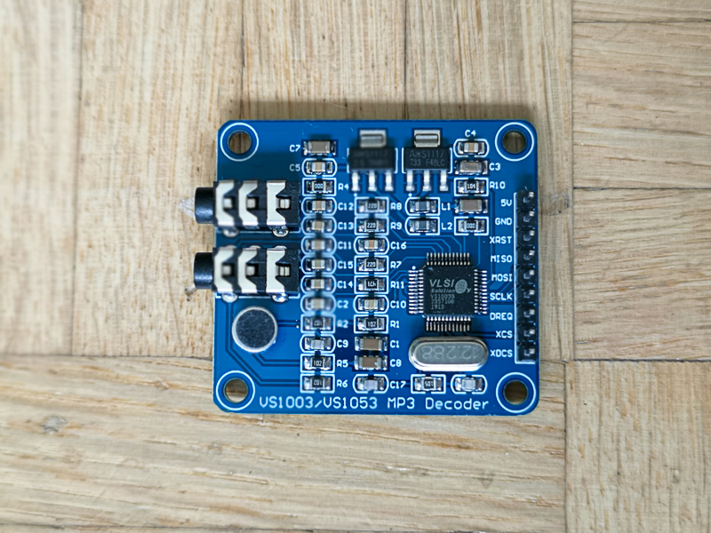
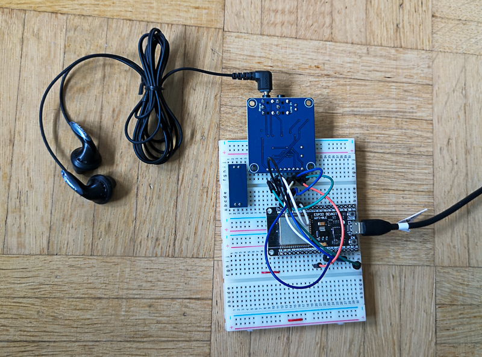
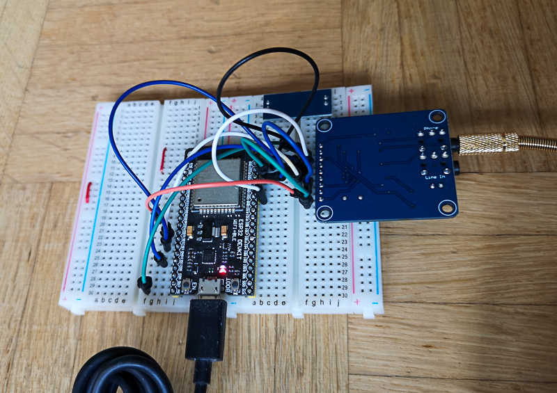

# Ein Webradio mit ESP32 und VS1003B

## Kann es wirklich so einfach sein?

Ja, das kann es! Aber beginnen wir von vorn.

## Hintergrund

Beim Durchsuchen meiner Kiste mit AliExpress-Bauteilen stieß ich auf ein Modul, das ich bisher noch nicht verwendet hatte: eine VS1003-/VS1053-MP3-Decoderplatine. Obwohl sie mit "VS1053" beschriftet ist, handelt es sich tatsächlich um eine VS1003-Platine.

Auf der Suche nach einer Python-Implementierung fand ich [hier](https://github.com/urish/vs1053-circuitpython) eine VS1053-Bibliothek von [Uri Shaked](https://github.com/urish) für CircuitPython.

Sie ließ sich recht einfach auf MicroPython portieren ([hier](https://github.com/KateiRen/vs10xx-micropython)), also konnte es losgehen.

Aus irgendeinem Grund bekam ich die SD-Karten-Erweiterungsplatine nicht mit meinem ESP32 zum Laufen. Woher sollte ich also MP3-Daten nehmen, um den VS1003 zu testen?

Radiostreams werden in verschiedenen Formaten angeboten, darunter auch MP3. Wie viel Aufwand wäre es, eine Verbindung zu einem MP3-Stream aufzubauen und die Daten kontinuierlich an den VS1003 weiterzugeben?

## In Betrieb nehmen

Es stellte sich heraus, dass es recht einfach ist, einen Socket anzulegen und eine Verbindung zu einem Webradiostream aufzubauen.

Der Knackpunkt: Häufig wird der Stream nicht direkt unter der ursprünglichen Adresse ausgeliefert. Stattdessen antwortet die erste Verbindung mit "302 FOUND" und einer neuen URL einschließlich eines Autorisierungstokens.

Wir müssen also die neue Adresse aus der Antwort auslesen und eine neue Verbindung samt Anfrage aufbauen.

Sobald das funktioniert, können wir fortlaufend Daten empfangen und an den VS1003 weitergeben.

Den Code findest du [hier](https://github.com/KateiRen/MicroPython-Webradio).

## Weitere Ideen

### Den Betrieb optimieren

Wie groß sollte der Puffer zwischen dem Empfang neuer Streamdaten und der Übergabe an den VS10xx idealerweise sein?

Ursprünglich wollte ich einen Stresstest erstellen, der systematisch verschiedene Puffergrößen mit immer längeren Unterbrechungen dazwischen ausprobiert. Das Radio spielt inzwischen aber schon seit mehr als zwölf Stunden ohne Unterbrechung. Die Puffergröße ist damit zwar vielleicht nicht ideal, aber offenbar schon gut genug.

### Drehencoder

Da die Radiosender in einem Array gespeichert sind, bietet sich ein Drehencoder geradezu an, um die Lautstärke zu regeln und zwischen den gespeicherten Sendern zu wechseln.

### Steuerung per MQTT

Wie bei diesen kleinen WLAN-fähigen Geräten üblich, ließe sich recht einfach ein MQTT-Client ergänzen, der ein Topic für Steuerbefehle abonniert. Damit könnte man das gesamte Radio aus der Ferne bedienen.
