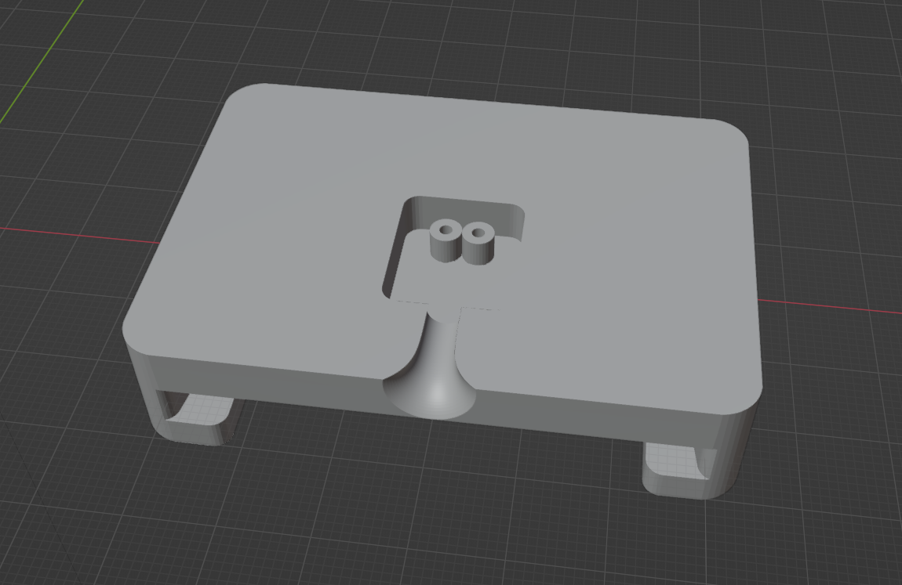
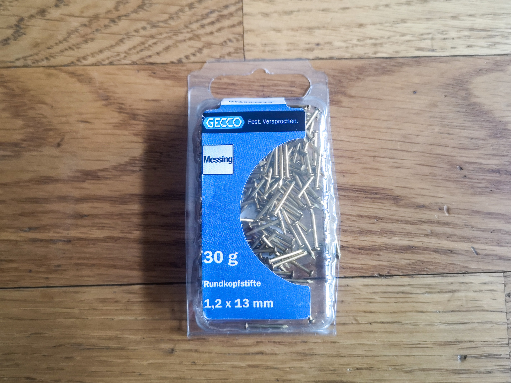
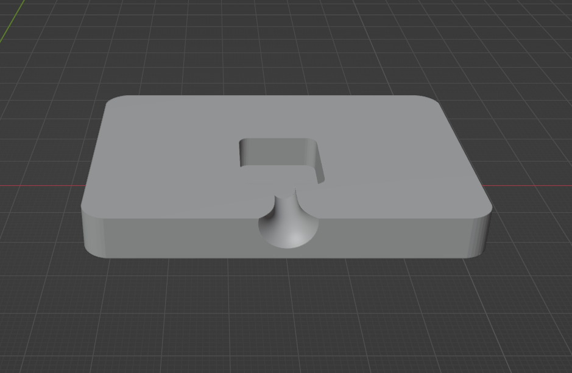
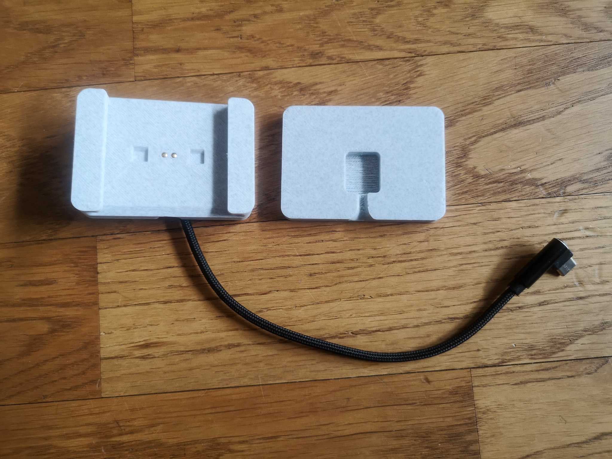
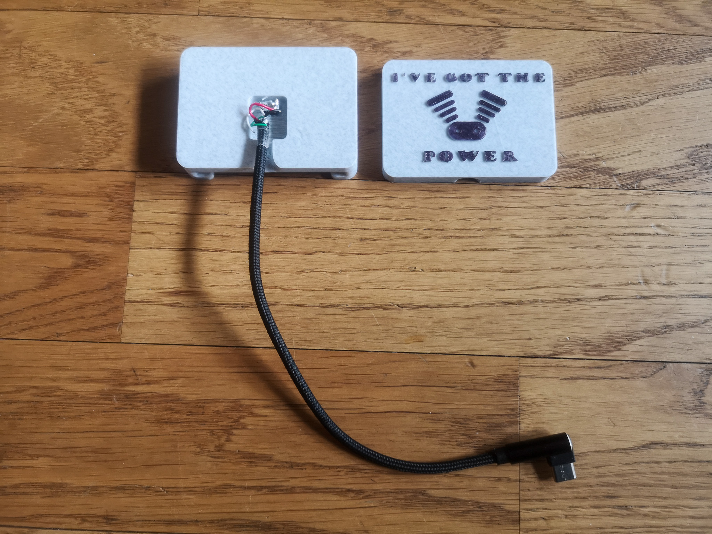
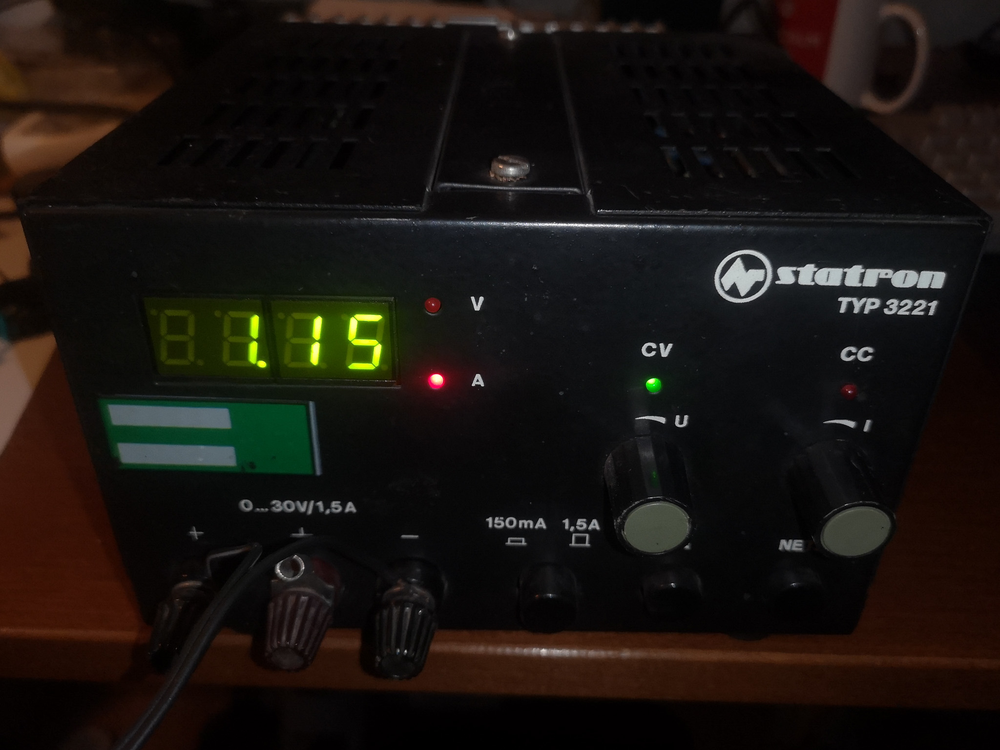
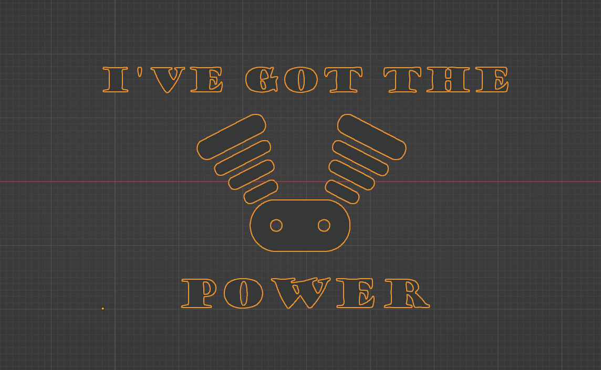
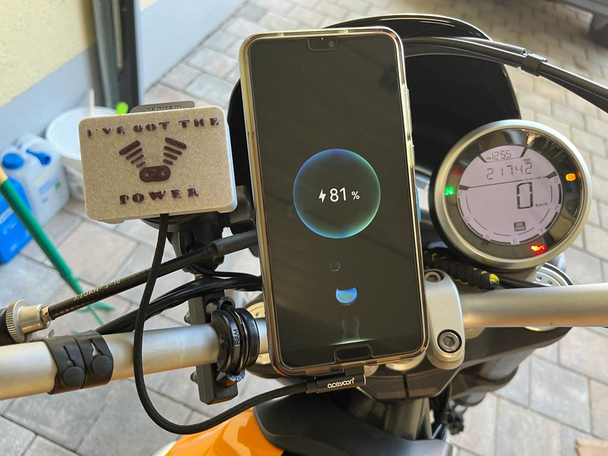

# Ein Adapter, der dein Smartphone über die Tomtom-Rider-Halterung mit Strom versorgt

## Ein Remix

Die ursprüngliche Idee und das Modell findest du hier:
[Printables.com: TomTom Rider mount adaptor | Power your phone from a sat-nav bracket](https://www.printables.com/de/model/72591-tomtom-rider-mount-adaptor-power-your-phone-from-a).

Meinen Remix findest du [hier](https://www.printables.com/de/model/414497-tomtom-rider-mount-adaptor-remix).

## Hintergrund

Die ursprüngliche Idee und Umsetzung des Adapters gefielen mir. Ich wollte mein Smartphone aber nicht direkt auf den Adapter setzen. Ich verwende ausschließlich PLA, das in der Sommersonne nicht besonders langlebig ist. Deshalb habe ich neben der Tomtom-Halterung eine Quad-Lock-Halterung für mein Smartphone montiert.

Der Adapter greift lediglich die Stromversorgung an der Tomtom-Halterung ab und leitet sie über ein USB-Kabel weiter.

## Änderungen

**Erste Änderung:** neue Bohrungen, die genau zu den unten gezeigten Messingnägeln passen.
Den im Originalmodell empfohlenen Messingstab mit 2 mm Durchmesser konnte ich nicht finden. Meine Lösung: kleine Messingnägel.

{: width="500" }
{: width="500" }

**Zweite Änderung:** ein neuer Kabelauslass, der nach unten zeigt. Außerdem habe ich ihn trichterförmig gestaltet, damit das Kabel nicht an der Kante der Öffnung abknickt.
Die Smartphone-Halterung sitzt rechts neben der Tomtom-Halterung, und ich wollte das USB-Kabel von unten anschließen.

{: width="500" }

**Dritte Änderung:** Ich habe das Gehäuse dicker gemacht, um mehr Platz für Kabel und Widerstände zu schaffen.
Bei der Verkabelung des Originalmodells ist Platz ein Luxus.

Wie sich herausstellte, hätte ich mir das sparen können: Mein Standard-Widerstandssortiment enthielt keine Werte, die auch nur annähernd das benötigte Verhältnis für den Spannungsteiler ermöglichten.
Also ließ ich die Widerstände ganz weg.

{: width="500" }

{: width="500" }

Ein Test am Labornetzteil zeigte, dass mein Smartphone auch ohne die Widerstände mit 1,15 A geladen wurde.

{: width="500" }

**Vierte Änderung:** Da das Oberteil nicht mehr die Smartphone-Halterung trägt, konnte die Oberfläche etwas Verschönerung vertragen. Ich habe ein kleines Logo mit Text entworfen, um die freie Fläche zu füllen.

{: width="500" }

## Ergebnis

Der Adapter passt gut auf die Tomtom-Halterung und liefert während der Navigation Strom:

