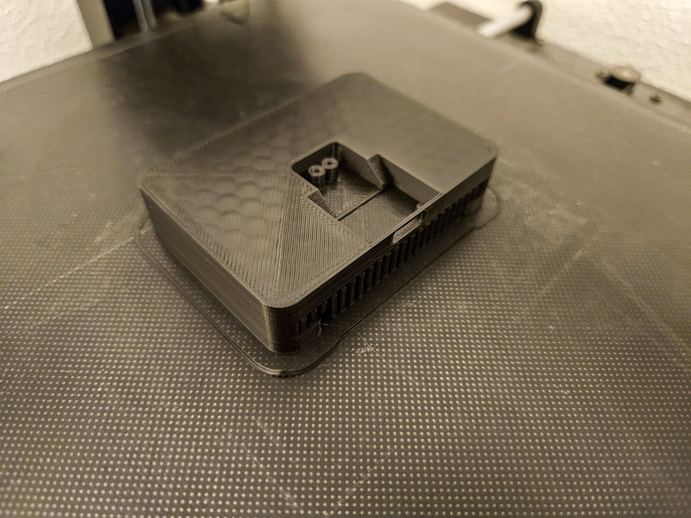
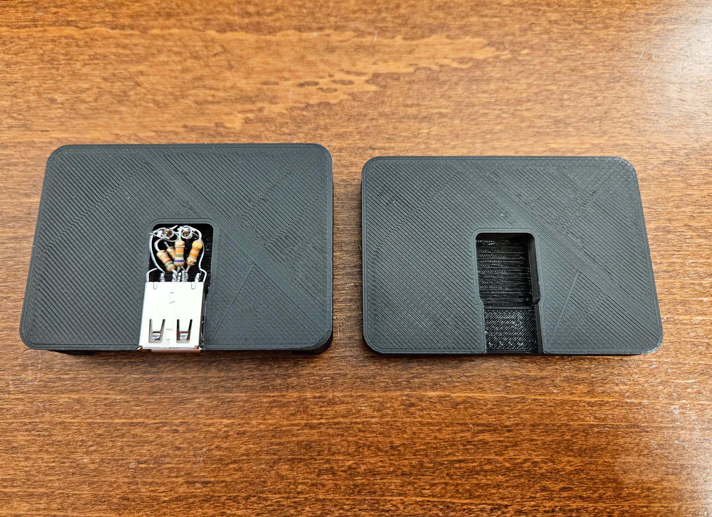
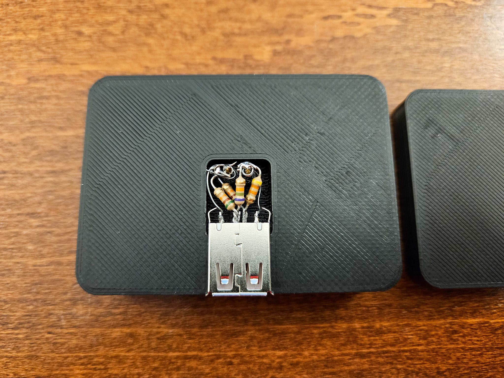
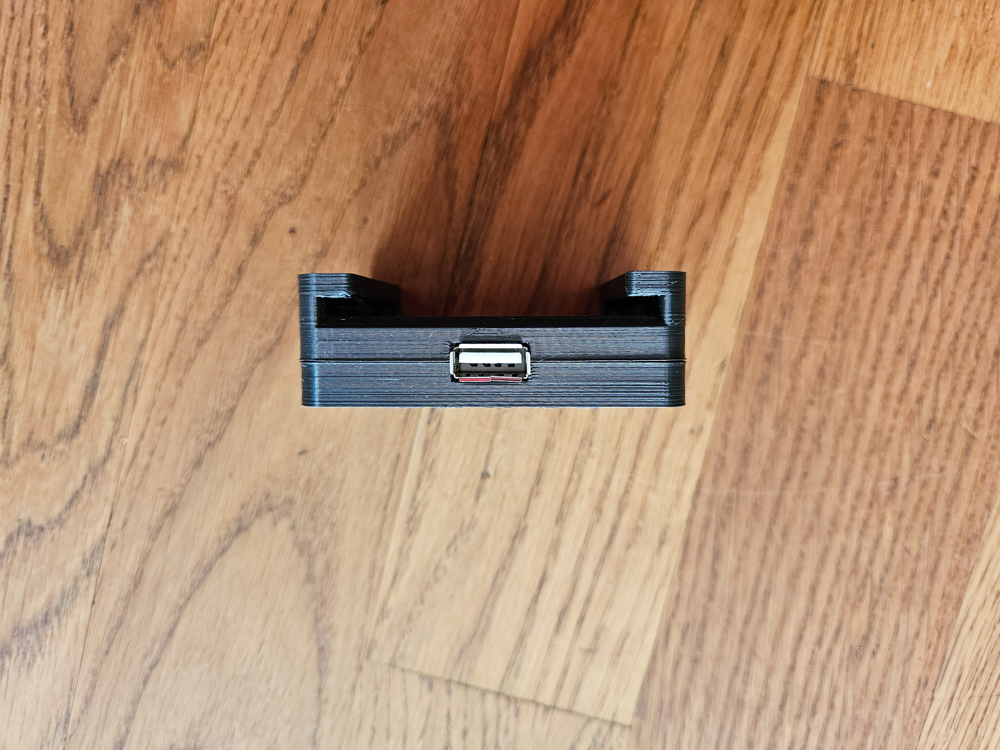
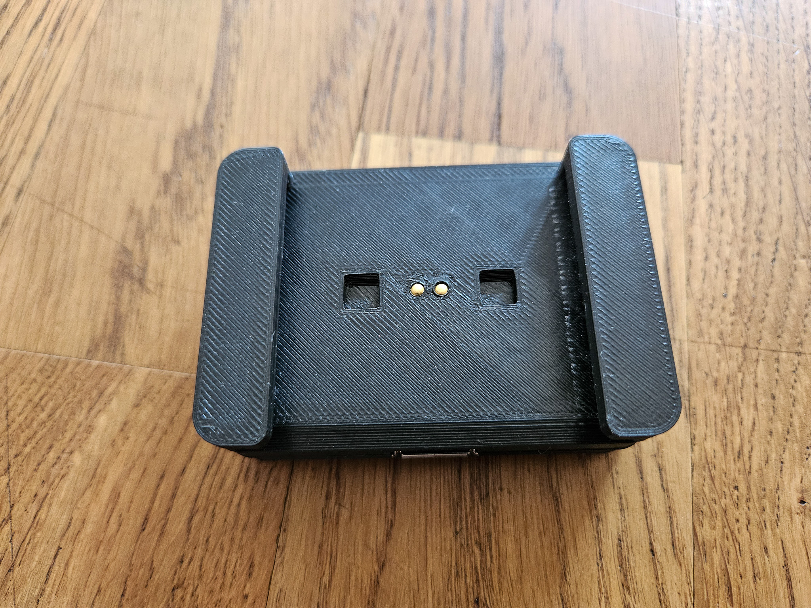
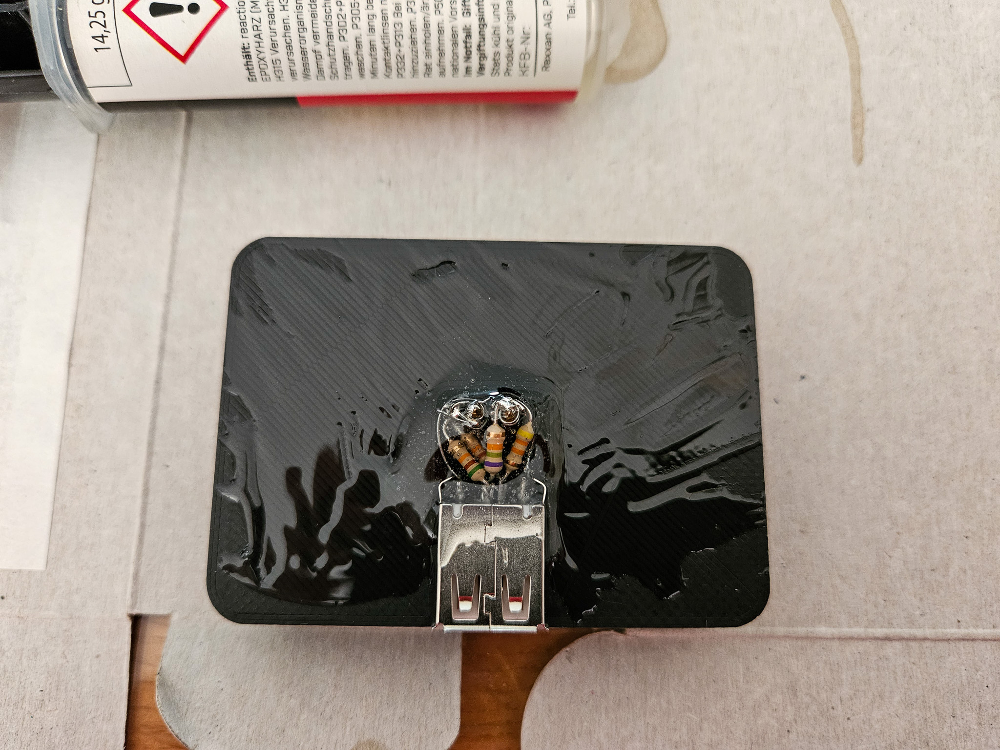
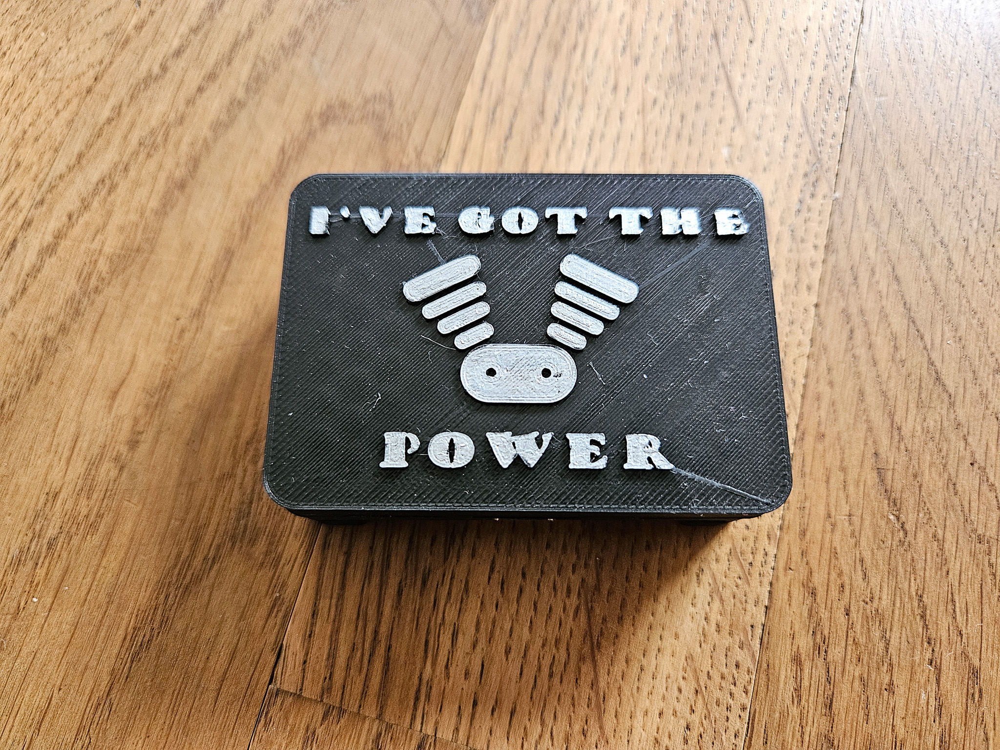

# Die zweite Version mit USB-A-Buchse

Es ist wieder so weit: Das Wetter wird wärmer, und die nächsten Motorradtouren rücken näher. [Der Adapter vom letzten Jahr]() hielt nicht ganz, was er versprach. Mehr als einmal war der Akku meines Smartphones während der Fahrt leer.
Ich bekam nicht genug Leistung aus dem Ladegerät, um das Smartphone während der Navigation ausreichend zu versorgen.

Deshalb begann ich erneut am Adapter zu tüfteln. Beim letzten Mal hatte ich die Anleitung nicht vollständig befolgt: Die erforderlichen Widerstände waren nicht in meinem üblichen Sortiment enthalten. Mehrere gewöhnliche Widerstände zu einem passenden Spannungsteiler zu kombinieren, war wegen des knappen Platzes im Gehäuse nicht möglich.

Diesmal bestellte ich genau die benötigten Teile und zusätzlich eine USB-A-Buchse, um bei der Verkabelung flexibel zu bleiben.
Informationen zur Anpassung des USB-Ladeanschlusses findest du übrigens hier: [https://learn.adafruit.com/minty-boost/icharging](https://learn.adafruit.com/minty-boost/icharging).

Nach einer weiteren Anpassung des 3D-Modells und einigen Tests konnte der Zusammenbau beginnen.

## Zusammenbau

{: width="500" }

{: width="500" }

{: width="500" }

{: width="500" }

{: width="500" }

{: width="500" }

## Ergebnis

Messungen am Labornetzteil zeigen, dass mein Galaxy S21 etwa 1 A aus der Buchse zieht, wenn sie mit 5 V versorgt wird.

Am Motorrad angeschlossen zeigt das Smartphone bei 58 % Akkustand an, dass es in einer Stunde und einer Minute vollständig geladen sein wird. Mal sehen, ob das auch bei eingeschaltetem Display, LTE und laufender Navigation ausreicht.

{: width="500" }
