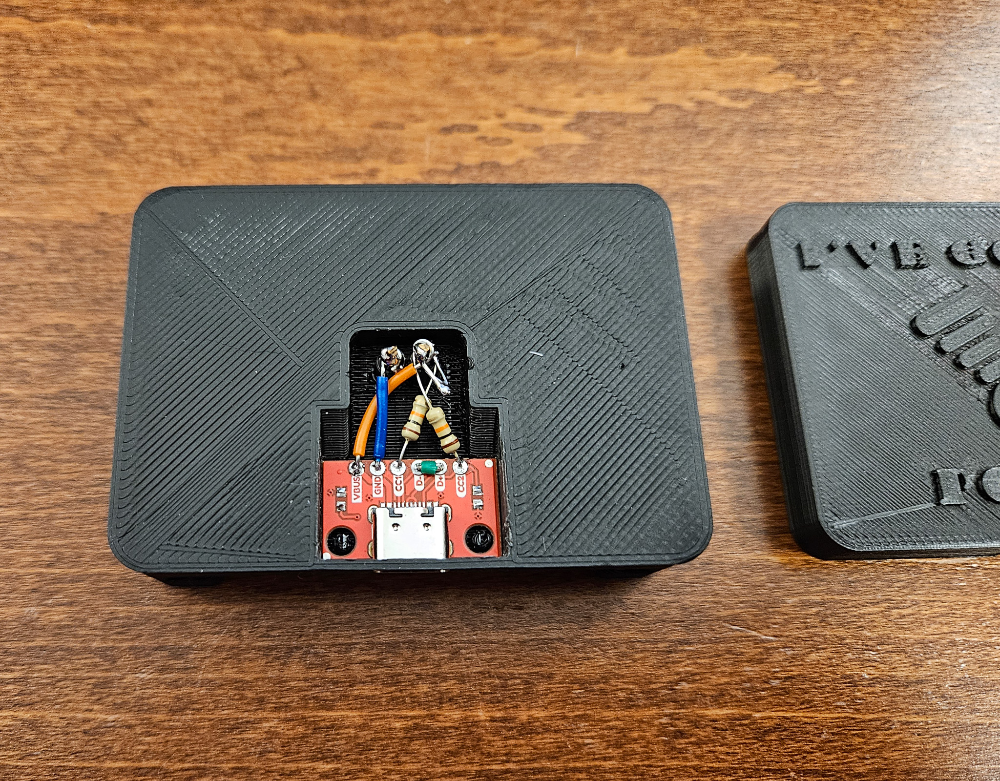
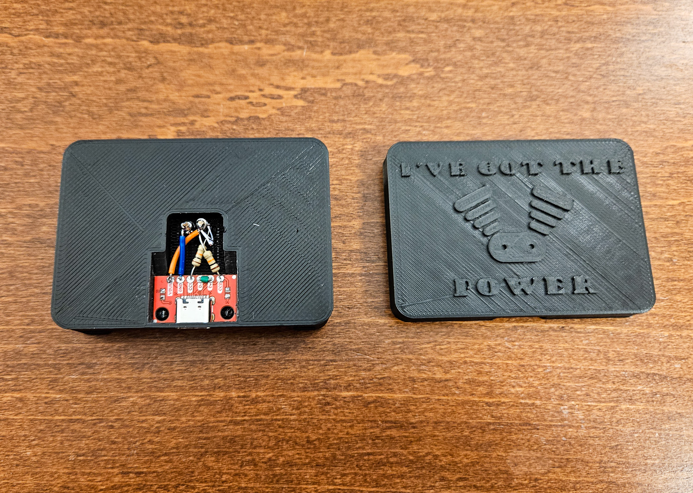
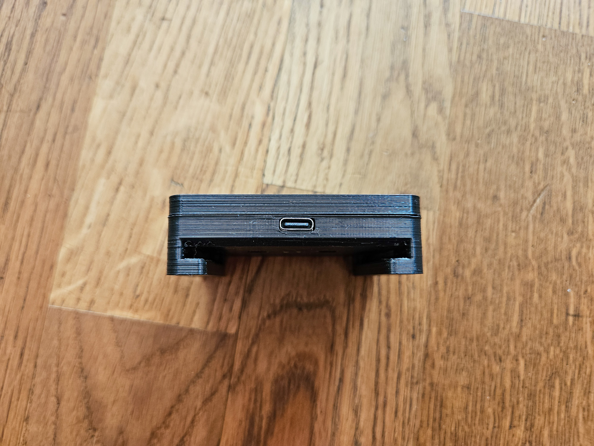
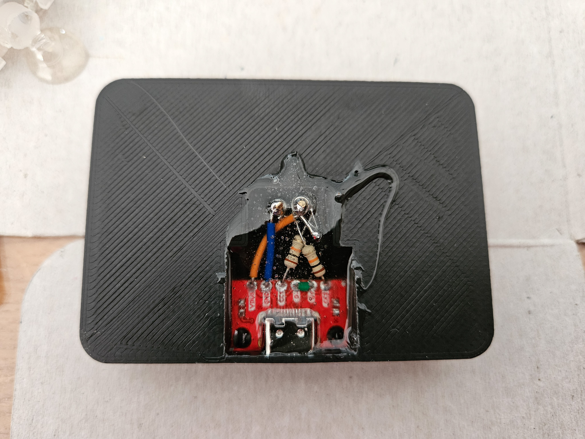
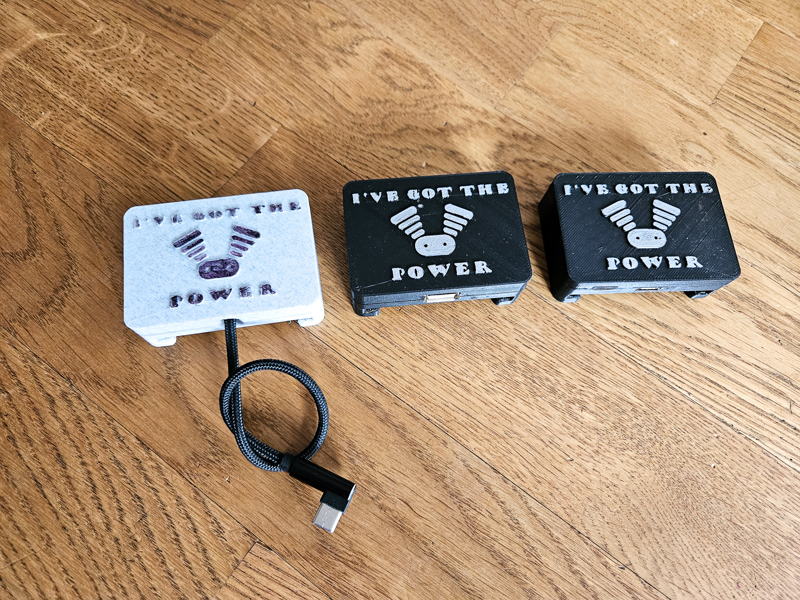

# Das Maximum herausholen: V3 mit USB-C-Buchse

Mit USB-A und 5 V scheint der maximale Ladestrom bei 1 A zu liegen.
Mit USB-C und 5 V sind offenbar 1,5 A möglich. Also bauen wir noch eine weitere, vielleicht letzte Version.

Zumindest laut dieser [Quelle](https://forum.digikey.com/t/simple-way-to-use-usb-type-c-to-get-5v-at-up-to-3a-15w/7016/33) sollte ein höherer Strom bei USB-C mit 5 V leicht zu erreichen sein. Laut Überschrift sollten sogar bis zu 3 A möglich sein.

Ich bestellte zwei USB-C-Buchsen. Schon ohne einen Versuch war klar, dass sich ihre winzigen Anschlüsse nicht mit meiner frei verdrahteten Widerstandsschaltung vertragen würden.

Es gibt aber auch praktische kleine Platinen mit bereits aufgelöteten USB-C-Buchsen.
Also noch einmal bestellen und warten.

Als die kleinen Platinen ankamen, musste ich nur das 3D-Modell erneut anpassen und ein passendes Gehäuse für die Platine daraus machen.

## Zusammenbau

## Ergebnis

Messungen am Labornetzteil zeigen, dass mein Galaxy S21 etwa 1,5 A aus der Buchse zieht, wenn sie mit 5 V versorgt wird. Nicht ganz die ebenfalls möglichen 3 A, aber immerhin mehr als die 1 A der vorherigen Version.

Die 3D-Modelle findest du [hier](https://www.printables.com/de/model/817171-tomtom-rider-mount-adaptor-remix-v3).
